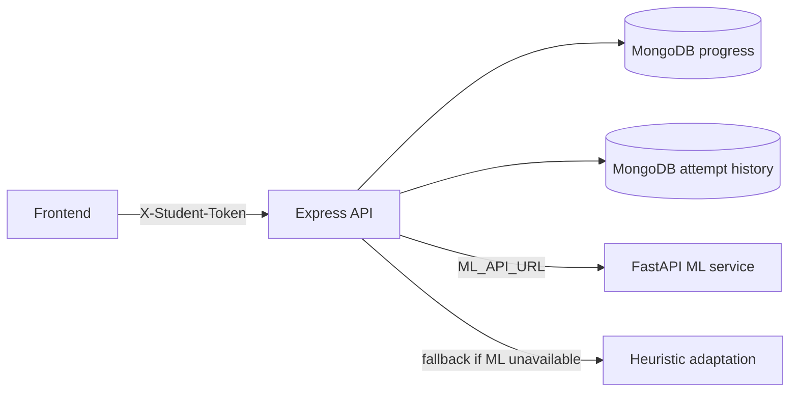

# StudyTwin

StudyTwin is an adaptive math-practice demo. The browser talks to an Express API; student progress is stored in MongoDB, and a separate FastAPI service can provide ML recommendations and step-classifier signals.

## Run locally

1. Install Node.js 20 or newer and Python 3.10 or newer.
2. Copy `Server/.env.example` to `Server/.env`. Set `MONGODB_URI` for persistent progress, **or** set `MEMORY_STORE=1` for a local demo without MongoDB. Never commit `.env` or credentials.
3. Install server dependencies from the project root:

   ```powershell
   npm ci
   ```

   For a reproducible clean install from the lockfile, use `npm ci` before running the checks.

4. Start the API:

   ```powershell
   npm start
   ```

5. Optionally start the Python ML API from `ML` in another terminal:

   ```powershell
   python -m pip install -r requirements.txt
   uvicorn api:app --host 127.0.0.1 --port 8000
   ```

   The FastAPI module and step-classifier model resolve paths from their source files, so it can also be launched from the project root with `uvicorn ML.api:app --host 127.0.0.1 --port 8000`.

   If the ML API is unavailable, the Node service uses a simple accuracy-based recommendation. ML predictions are supporting signals, not validated assessments of a learner.
6. The Express server also serves the frontend as static files, so opening `http://localhost:3000` is enough.

## ML model

The student performance model (`model/model.pkl`) is excluded from the repository. After a fresh clone you must retrain it before starting the ML service:

```powershell
cd ML
python model.py
```

`model.py` reads `data/studytwin_ml_training_data.csv`, trains a Logistic Regression pipeline, and writes the model to `model/model.pkl`. The training data is synthetic and checked in. `ML/step_misconception_model.pkl` is checked in for step analysis. Install the pinned Python dependencies with `python -m pip install -r ML/requirements.txt` from the repository root.

## MongoDB progress storage

The server stores each student document in the `student_progress` collection of `MONGODB_DB_NAME` (default: `studytwin`). Each browser gets its own random student id and session token generated in `localStorage`.

Starting a session, submitting an answer, reading either profile endpoint, and resetting a student require the `X-Student-Token` header. Missing or mismatched tokens are rejected with HTTP 403. The frontend sends the token automatically on every request. Profiles created before token binding are denied rather than exposed by student ID.

This is a demo-level browser-session check, **not authentication**. The token is stored in browser local storage and protects against accidental access by someone who only knows a student ID; it does not establish a verified identity or protect against a compromised browser. Do not collect real student data or expose the demo publicly without server-side authentication and authorization.

The attempt-export API is disabled unless `ATTEMPT_EXPORT_TOKEN` is configured. When enabled, send it in the `X-Admin-Token` header. The CLI export command accesses MongoDB directly and should be run only by an authorized operator.

Raw submissions (answer, work, labels) append to the separate `student_attempts` collection for labeling and evaluation. Export them with:

```powershell
npm run export-attempts -- --format csv --out attempts.csv
```

For blind labeling (system labels omitted, empty `gold` column added):

```powershell
npm run export-attempts -- --blind --format csv --out to_label.csv
```

With `MEMORY_STORE=1`, progress and attempts stay in memory until the process exits (fine for local demos). The export script reads from MongoDB and will see zero rows in memory-store mode.

**Retention policy:** There is no automatic expiry. MongoDB retains progress and raw answer/work history until the student resets or an operator deletes it. Reset permanently deletes both the student's `student_progress` document and every `student_attempts` row for that student ID. The reset screen names both data sets. The API reports completion only after both deletions are confirmed; if storage fails partway through, the UI reports an unconfirmed result and keeps the browser identity so reset can be retried. If a submission cannot confirm both its attempt log and progress write, it is not shown as saved; the error explains that it may have been partially recorded. Exported CSV/JSON files and any provider-managed backups are separate copies and are not removed by the app reset; their owners/providers must manage their retention.

## Personalized learning dashboard

The dashboard (click **View My Progress** in the sidebar) shows:

- **Demonstrated mastery** (correct answer and sound work) and **final-answer accuracy** (numerical answer correctness), alongside learning level and misconception count.
- **Common mistakes** with the most affected concept and recurrence count.
- **Misconception trends** — each tracked error's rate in the most recent 10 attempts compared with the 10 before them. Fewer errors is **Improving**; an unchanged or higher rate is **Needs more practice**. Fewer than 20 saved attempts is **Not enough attempts yet**.
- **Next learning step** — the concept that needs the most attention right now. A recurring misconception can start a three-question progression in that concept, moving from easier to harder questions, recording how often that specific error appears, then returning to mixed algebra practice.
- **Concept mastery** — a progress bar per concept, showing accuracy and current difficulty.
- **Concepts needing most practice** — the same list ranked by accuracy, showing the count of detected errors per concept.
- **Recent attempts** — the last five submissions with concept, difficulty, result, and the mistake label if one was detected.
- **StudyTwin recommendation** — a plain-language summary derived from overall accuracy.

## Adaptive learning loop

After each answer, the ML model (or heuristic fallback) estimates the probability of the student answering correctly at the current difficulty. The system then:

- **Decreases difficulty** if the probability is below 40 %, so the student gets stabilising practice.
- **Holds difficulty** if the probability is between 40 % and 75 %, to consolidate the current level.
- **Increases difficulty** if the probability exceeds 75 %, to keep the student challenged.

The feedback panel shows the current probability, the resulting difficulty change, and the ML recommendation text after every submission.

If a student makes the same misconception at least twice, the dashboard offers **Practice this mistake**. It starts a focused three-question progression in the affected concept and records the question outcomes. Later attempts in that concept are tagged as follow-up for that practice session. The dashboard compares the last 10 pre-practice attempts with the first 10 subsequent attempts for that error type, and leaves the status provisional until both windows contain 10 records.

## LLM step review

Set `GEMINI_API_KEY` and `GEMINI_MODEL=gemini-3.8-flash` in `Server/.env` to enable native Gemini `generateContent` review. The key stays on the server. If Gemini is configured, it takes precedence over the legacy `LLM_*` values; a Gemini model in `LLM_MODEL` also uses `LLM_API_KEY` as a compatibility fallback. An OpenAI-compatible provider can still be configured with `LLM_API_URL`, `LLM_API_KEY`, and `LLM_MODEL` when Gemini is not configured. Review helps interpret submitted work, including arrow chains, prose, and parser-readable equations, and can suggest one of these five step labels:

Verify the Gemini key and live provider connection with `npm run check:gemini` from the project root. The check submits only a synthetic equation and work sample.

- `sign_error`
- `wrong_inverse_op`
- `one_sided_op`
- `combining_unlike_terms`
- `arithmetic_slip`

Final-answer correctness is determined locally by deterministic comparison; the LLM cannot mark a wrong answer correct or a correct answer wrong. If its response does not identify a permitted label and an exact submitted line, deterministic rules and then ML supporting signals still analyze the work. LLM corrections are displayed only when the equation parser confirms they are equivalent to the preceding submitted equation and distinct from the invalid step. Otherwise, feedback uses a hint without presenting an unverified correction. The service sends the question, submitted answer, correct answer, and at most 4,000 characters of work to the configured provider; it does not send the student ID. Do not enable a provider unless its data-handling terms are suitable for the students using the app.

After submission, feedback shows the identified incorrect line, an equivalent corrected step when the rule path is known, an explanation, and a targeted hint. The submitted work and worked solution are returned with the submission response; answer and solution content are not included when the question is first loaded. A correct final answer with a detected error in the written work is not counted as demonstrated mastery. If there is no work to inspect, the app asks the student to show steps rather than inventing a diagnosis.

## Reliability and privacy

**MongoDB unavailable during submission.** If writing either the raw attempt or progress fails, `POST /api/sessions/answer` returns HTTP 503 with `success: false`, `persisted: false`, and `persistenceState: "unconfirmed"`. Because MongoDB can fail after accepting a write, the UI says the submission may be partially recorded and asks the student to check the profile before retrying. A successful response includes `persisted: true` only after both writes finish.

**MongoDB unavailable during reset.** Reset deletes attempt history first, then progress. The API reports which deletion completed if the second step fails. The UI does not clear the browser's student ID or token until both deletions are confirmed, so the student can retry. MongoDB does not provide a cross-collection transaction in this demo; a partial reset is reported as unconfirmed, never as complete.

**Express server unavailable.** The frontend's `api()` helper catches network errors and shows a user-facing message. The connection pill in the top-right updates to "API offline" via the `/health` ping on load.

**Demo-level profile isolation.** Session creation, answer submission, profile reads (including concept profiles), and resets require a matching `X-Student-Token` header. The test suite verifies missing and mismatched tokens are denied. The public attempt-export API is disabled unless an `ATTEMPT_EXPORT_TOKEN` is configured. These checks reduce accidental cross-profile access, but they are not user authentication or a substitute for server-side authorization.

**Anonymous demo profiles.** Each browser independently generates a UUID student ID and a separate session token on first load, persisted in `localStorage`. There is no shared login and no name or email collected. A user can still manipulate browser state or make direct API requests; do not use this setup for real student data.

## Deploy to Vercel

The repository includes Vercel configuration for the static frontend and a serverless Express API. In Vercel, import the project with the project root set to this directory, then configure these environment variables before deploying:

- `MONGODB_URI` (required; use a MongoDB Atlas connection string)
- `MONGODB_DB_NAME` (optional; defaults to `studytwin`)
- `ATTEMPT_EXPORT_TOKEN` (optional; required to enable the protected attempt-export API)
- `GEMINI_API_KEY`, `GEMINI_MODEL` (optional; Gemini native review, recommended)
- `LLM_API_URL`, `LLM_API_KEY`, `LLM_MODEL` (optional)
- `ML_API_URL` (optional; point it to the separately hosted FastAPI ML service's public base URL, e.g. `https://studytwin-ml.example.com`; do not use `127.0.0.1` in a hosted Node deployment)
- `CORS_ORIGINS` (comma-separated exact frontend origins when frontend and API are hosted on different domains; empty by default)
- `TRUST_PROXY_HOPS` (default `0`; set only to the exact number of trusted proxy hops in the hosting topology)

Deploy the Node API/frontend with the Vercel CLI (`vercel --prod`) or dashboard. Vercel does not host the included FastAPI service through this configuration. To deploy ML separately, build the container from the repository root with `docker build -f ML/Dockerfile -t studytwin-ml .`, publish it to a container host, and set the Node deployment's `ML_API_URL` to that service's public base URL. The image trains the student model from the checked-in synthetic dataset and includes the step model. Set CORS origins on the Node API only when the UI is served from a different origin. If no reachable `ML_API_URL` is provided, the Node API uses its heuristic fallback; never commit credentials or add them to frontend code.

Before calling ML deployment verified, set `ML_API_URL` in the Node environment to the hosted URL and run `npm run check:ml` from the project root. This checks `/health` and submits a real sample payload to `/predict`. Then complete a browser submission against that same deployed Node API and confirm the response reports `adaptation.source: "ml"`; the app deliberately falls back to a heuristic if prediction fails. A passing local service check is not proof of a deployed service.

## Rate limiting

`POST /api/sessions/answer` is rate-limited per client IP (defaults: 30 requests/minute and 200 requests/day). Override with `RATE_LIMIT_ANSWER_PER_MIN` and `RATE_LIMIT_ANSWER_DAILY`.

The limiter uses Express's validated `req.ip`. Forwarded headers are ignored by default; configure `TRUST_PROXY_HOPS` only for a known hosting topology that overwrites/appends those headers. Never trust arbitrary forwarded headers on a directly reachable server.

The counters are in-memory. On Vercel each serverless instance has its own counters, so they do not accumulate across instances. For a shared persistent counter, replace `windowCount()` in `Server/middleware/rateLimit.js` with an atomic increment against Upstash Redis or MongoDB. Enable the LLM only after confirming rate limits work end-to-end.

## Evaluation

Run automated checks from the project root:

```powershell
npm test
npm run eval
```

`npm run eval` runs three hand-written sets with the LLM disabled. Results as of 23 October 2026:

| Set | Cases | Final-answer accuracy | Exact misconception label | Notes |
|-----|------:|----------------------:|-------------------------:|-------|
| Main | 63 | 100% | 100% | Written alongside rule development |
| Stress | 24 | 100% | 100% | Designed to break the rules; rules fixed against them |
| Unseen | 31 | 100% | 100% | Written independently, not used during tuning |

**Important:** All three sets score 100% and that metric is now saturated. The cases were written by the same person who wrote the detection rules. Treat `npm run eval` as a **regression guard**, not proof of generalization to real students. The meaningful benchmark is real student work collected, exported blind, and labeled by a second person (see below).

### Real-data benchmark (the meaningful number)

1. Collect attempts by running the server with `MONGODB_URI` set and having classmates use the app.
2. Export a blind copy (system labels hidden):

   ```powershell
   npm run export-attempts -- --blind --format csv --out to_label.csv
   ```

3. Open `to_label.csv` and fill in the empty `gold` column for each row. Valid labels: `correct`, `failed_to_distribute`, `sign_error`, `wrong_inverse_op`, `one_sided_op`, `arithmetic_slip`, `combining_unlike_terms`, `no_evidence`. Leave rows blank to skip them.

4. Score against the real data:

   ```powershell
   npm run eval -- --real-data to_label.csv
   ```

This is the number to quote when discussing how well the system generalises to real students.

## Demo journey

Run this only with a synthetic profile (`MEMORY_STORE=1`); do not enter classmates' or other real student data. Start the Node API with the ML service online if you want to demonstrate ML adaptation, then open `http://localhost:3000`.

1. **Create a pre-practice baseline.** Submit 10 Distributive Property questions. Include four `failed_to_distribute` errors and six attempts with valid distribution work. For the error example, on `2(x + 3) = 14`, submit the correct final answer `4` but write `2x+3=14 -> 2x=8 -> x=4`. This shows that final-answer correctness and demonstrated mastery are different.
2. **Show the correction.** The feedback should keep the final answer marked correct, identify the invalid distribution transition, show a valid correction (`2x+6=14`), and indicate that mastery was not demonstrated. For a wrong-answer variant, submit `5.5` with the same flawed chain.
3. **Start focused practice.** Open the dashboard. The repeated distribution mistake should offer **Practice this mistake**. Complete the three focused questions; the banner shows the targeted misconception and the summary records matching errors among those three questions.
4. **Measure later performance.** Continue with 10 further Distributive Property attempts and use valid distribution steps. Reopen the dashboard. It compares the actual matching-error counts: 4/10 before focused practice against 0/10 in subsequent practice, and reports **Improving**. If fewer than 10 later attempts are saved, the status stays **Not enough follow-up attempts yet**.
5. **Explain the limit.** The 3-question activity and 10-attempt follow-up illustrate a recorded short-term change only. They do not establish durable mastery or a causal effect. Keep the profile synthetic, label any screenshots “synthetic demo data,” and do not present the result as evidence about real learners.

### Architecture



The screenshot capture should use the synthetic demo profile only. The project does not include a screenshot asset yet; add reviewed captures under `docs/screenshots/` before distributing a presentation copy.

## Limitations

- The student-model training data is synthetic. It does not establish generalization to real learners or classrooms.
- All three hand-written evaluation sets score 100%; that is a regression guard, not proof of generalization. Use exported and labeled real attempts for an unbiased benchmark.
- The LLM review is optional, has not been benchmarked on real student data, can make mistakes, and depends on the configured provider. It cannot determine final-answer correctness; it can still produce inaccurate step labels or explanations.
- Exact step corrections depend on the supported rule checks or configured LLM review. Alternative valid methods and unclear work may not yield a specific correction.
- ML is supporting data for adaptation and step analysis; its probabilities and labels are not calibrated educational or high-stakes decisions.
- The in-memory rate limiter is per-process and resets when the process restarts. A shared classroom or NAT network shares one IP budget across all students.
- Progress is persisted in MongoDB; this demo does not include multi-user authentication beyond the per-browser session token. Do not expose real student records publicly without adding proper authentication.
- The Vercel setup hosts the Node API and frontend only. The Python ML API must be hosted separately if its predictions are needed.
- No hosted ML URL is configured by default. Local FastAPI health/prediction checks do not verify a remote deployment; use `npm run check:ml` against the production Node environment, then verify a complete browser submission there.
- Anonymous browser tokens are not identity verification. Before collecting classmates' work, add account authentication and authorization, durable shared rate limits, a reviewed privacy notice, and a verified deletion process. For a classroom demo, use synthetic data only.
- `model/model.pkl` is not committed to the repository. Run `python ML/model.py` after cloning to retrain it.
